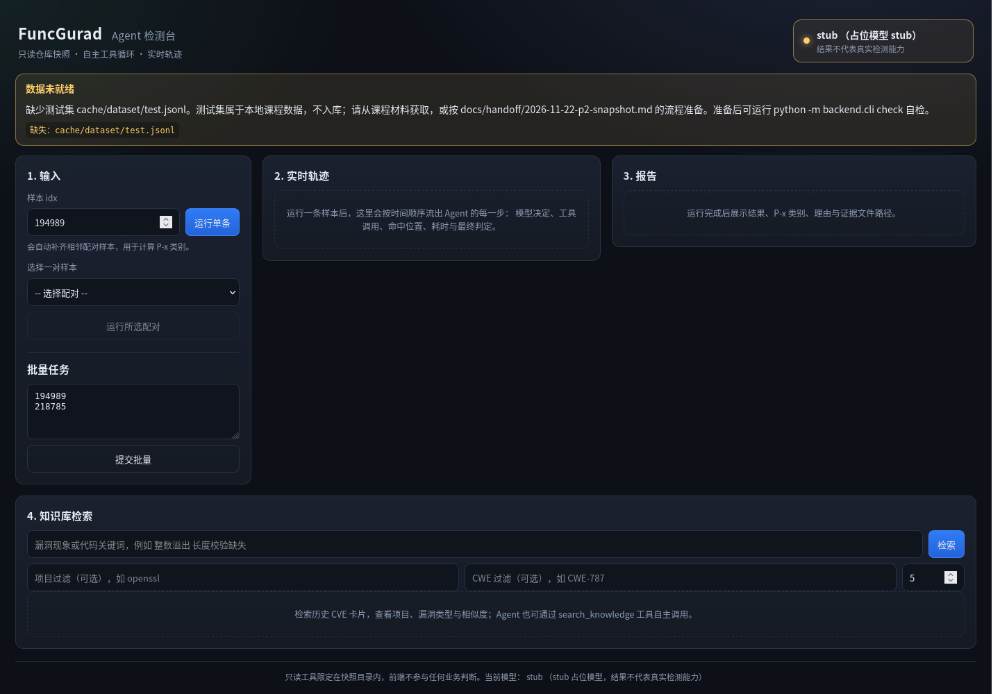

# FuncGurad 函数漏洞检测智能体工具 · 中期汇报大纲

> 朱辰 · 2026.11.26 · 中国科学院大学《高级软件工程》
>
> 组号待补。项目代码库见 [zhu-chen/FuncGurad](https://github.com/zhu-chen/FuncGurad)。

## 一、团队组成与协作

团队没有采用传统的“一人负责一个模块、按顺序交接”的开发模式。考虑到组员的空闲时间不同，大家也普遍使用 Agent 辅助开发，我们参考了 Anthropic Agent Teams 的协作思路，采用“任务池”组织开发。每位组员都可以参与项目各个模块的开发和维护。

组员根据自己的时间和兴趣从任务池中认领任务，写明认领人和日期。完成后提交 PR，记录验证结果。任何组员也可以把发现的新任务放回池中，供其他人接手。例如，知识检索接口合并后，团队将收紧泄漏阈值列为一项独立任务，完成后又复查了已生成的知识卡片。[任务清单](../../../.agents/TODO.md) · [进展记录](../../../.agents/PROGRESS.md)

| 成员或提交账号 | 已完成的工作 |
| --- | --- |
| 朱辰（zhu-chen） | 建立仓库、初始文档与协作流程，整理课程要求与实现的对照表，补充开发环境和测试说明。 |
| sseevv（姓名待确认） | 实现快照与函数定位、Agent 工具循环、检测台和 BM25 检索，完成知识库泄漏审计，建立离线测试基线。 |
| 赵志浩（zhao-zhihaoshangan） | 接入 GLM-5.3-Flash，开发可断点续跑的全量评测脚本，完成 300 条预测并核对课程评分。 |

## 二、项目意义与目标

一个 C/C++ 函数中的长度参数可能已由调用方校验，也可能直接来自外部输入。仅凭函数片段，两种情况容易得到相同的判定。FuncGurad 的目标是让代码审查者看到 Agent 为什么判定有漏洞或无漏洞，以及它参考了哪些历史案例、读过当前版本的哪些代码。

课程要求用户能提交函数和修复提交链接，或上传一批样本。Agent 先检索课程提供的历史 CVE 案例，形成初判，证据不足时再读取指定版本仓库。用户在界面中查看分析过程，最终取得每个样本的编号、判定、理由和分析记录。[课程任务要求](../../../ref/3.%20函数漏洞检测智能体工具.md)

## 三、技术方案与系统设计

| 环节 | 实现与设计依据 |
| --- | --- |
| 界面与运行编排 | Vue 3 检测台通过 FastAPI 启动任务、轮询分析轨迹、读取报告。后端逐样本创建独立的模型会话。 |
| 仓库上下文 | 原生 Git 按修复链接获取版本。漏洞版取修复提交的父提交，修复版取修复提交本身。每次推理只提供一个函数，三个只读工具可查找文件、搜索内容、读取片段，路径访问受 `SnapshotGuard` 限制。 |
| 历史案例检索 | 将课程历史 CVE 整理成知识卡片，通过本地 BM25 索引按关键词相关性检索。建索引前剔除与测试函数过度重合或涉及相同泄漏线索的记录，建索引后再审计卡片。 |
| 自主决策与证据 | GLM-5.3-Flash 通过 function calling 选择知识检索或仓库工具，也可结束分析。若模型判定有漏洞，后端检查是否有成功的工具调用、是否给出证据，以及至少一个证据路径能否在快照中找到对应文件。条件不足时将判定改为无漏洞。 |
| 存储与评分 | 本地文件保存快照、索引和运行记录。`result.jsonl` 每行仅保存 `idx` 和整数 `prediction`，供课程脚本评分。理由与证据进入 `report.json`，逐步调用进入 `trace.jsonl`，供界面回看。 |

### 主要功能的 BDD 用户故事

| 场景 | Given（前提） | When（操作） | Then（可观察结果） | 中期状态 |
| --- | --- | --- | --- | --- |
| 审查一个函数 | 审查者有函数源码和修复提交链接 | 填入两项内容并启动检测 | 获得该函数的编号、判定、理由和分析记录 | 已支持按预置 idx 启动，默认补齐同对样本并分别推理。源码与链接输入待补。 |
| 复核一次判定 | 检测任务已启动 | 审查者打开实时轨迹，再查看报告 | 可按时间查看本次工具调用，并按证据路径核对判定理由 | 已支持轨迹与报告。当前提示词优先定位函数，课程要求的先检索再初判仍待验收。 |
| 批量评测 | 评测者持有多条样本的 JSONL 文件 | 上传文件并启动批量检测 | 各样本独立分析，按 idx 获取报告与预测 | 已支持提交 idx 列表，已生成全量预测。文件上传入口待补。 |

### 低保真界面与当前实装

下图是课程验收时的目标界面。左侧两种输入共用同一套轨迹和报告视图。

```text
输入                        本次分析轨迹                 样本报告
[单个函数] [批量上传]        历史案例检索与命中结果        idx / 有漏洞或无漏洞
[粘贴 C/C++ 函数   ]        初步判断与待核实问题          判定理由
[填写修复提交链接  ]        按需读取的文件与代码位置      证据路径与行号
或 [选择 .jsonl 文件]       结束分析                     [查看该样本记录]
[启动检测]
```

下图为当前检测台启动页的实机截图。左侧支持单个 idx、配对和批量编号，中间显示轨迹，右侧显示报告，下方可检索历史案例。截图使用 stub，处于本机课程数据未就绪的状态。



## 四、开发进展与评测结果

| 时间 | 里程碑 | 可复核的成果 |
| --- | --- | --- |
| 11 月 22 日 | 打通从快照到报告的流程 | 6 条样本验证快照与函数定位。CLI 和 Web 检测台接通 Agent，使用 stub 验证调用、轨迹和报告展示。 |
| 11 月 23 日 | 接入历史知识和真实模型 | 从 7,574 条唯一知识卡片中剔除 77 条，7,497 条进入索引。在包含度阈值 0.5 下复查，残余命中 0 对。GLM-5.3-Flash 已跑通工具调用。 |
| 11 月 24 日 | 完成全量评测和离线测试基线 | 300 条预测全部参与评分。团队记录的离线回归结果为 90 项通过、1 项跳过、1 项已知问题按预期失败，覆盖配对评分、路径限制、证据门控、产物格式、检索和 API。 |

### GLM-5.3-Flash 在 150 对样本上的表现

11 月 24 日，团队用 GLM-5.3-Flash（`is_stub=false`）对 43 个来源仓库的 300 条样本各自推理，再将同一函数的漏洞版与修复版配对计分。课程评分脚本与项目评分脚本给出相同的全量结果。[全量评测记录](../../handoff/2026-11-24-p7-full-eval.md) · [提交的预测文件](../../../result.jsonl)

| 统计范围 | 配对数 | P-C 两版均对 | P-V 两版均报有漏洞 | P-B 两版均报无漏洞 | P-R 两版均反 | 课程等级 |
| --- | ---: | ---: | ---: | ---: | ---: | --- |
| 全部样本 | 150 | 55 | 67 | 20 | 8 | A |
| 两版均有真实仓库快照的子集 | 94 | 36 | 41 | 13 | 4 | A |

- **课程等级 A。** 55 对的两版均判对，达到 A 的门槛（30 对）。两版均判反的有 8 对，未触发超过 P-C 一半的降级条件。
- **最常见的结果是两版均报有漏洞。** 67 对属于 P-V，加上 8 对 P-R，共有 75 个修复版被误报，占 150 个修复版的一半。下一轮优先复核模型在修复版上引用了什么证据。
- **快照覆盖影响结果解读。** 194 条样本取得真实仓库快照，另有 106 条因限流或提交不可达，只能用输入函数文本生成快照。这些样本缺少其他仓库文件，表中第二行单列两版都能读取真实仓库的配对。

## 五、项目特色

- **让历史案例和当前代码各有出处。** 历史案例帮助提出疑点，报告中的文件路径则让审查者回到本次快照核对代码。即使模型看到了相似案例，仍要为当前函数的漏洞判定提供证据。[Agent 实现](../../../backend/agent/loop.py)
- **从知识库和推理输入两处隔离测试样本。** 索引前后复查相似代码，减少通过检索直接命中测试案例的机会。测试时每次只读一个版本，不提供版本差异，两个独立判定汇合于配对评分。[知识库审计](../../p3-knowledge-leakage-audit.md) · [评分实现](../../../bench/score.py)

## 六、当前问题与下一阶段安排

| 顺序 | 待解决的问题 | 工作与验收方式 |
| --- | --- | --- |
| 第一阶段 · 课程输入与流程 | 界面依赖预置 idx，模型可能跳过知识检索。 | 补齐函数加链接、JSONL 上传两个入口。各走通一次，在当次轨迹中核对先检索、再初判、按需读仓，明确记录模型自主选择的工具和结束时机，并与课程方确认自建 Agent 循环的验收口径。 |
| 第二阶段 · 仓库覆盖 | 106 条样本只有函数文本，无法检查调用方或跨文件定义。 | 优先补取缺失最多的 TensorFlow 快照（65 条）。用取得的真实快照重新检测相应样本，记录替换条数，并对相同样本比较前后判定。 |
| 第三阶段 · 误报与交付 | 修复版误报集中，现有评分能指出错误分布，具体原因要结合报告确认。 | 抽查 P-V、P-R 的工具轨迹与证据，核实模型是否忽略了已有校验，或是否缺少必要上下文。调整后用相同评分规则报告四类计数，并检查漏洞版漏报是否增加。最终交付检测台、样本报告和 300 行预测文件。 |

下一阶段按验收先后排列，具体日期与认领人由团队在任务池确定。[课程验收对照](../../handoff/2026-11-24-course-requirements.md) · [中期汇报要求](中期汇报要求.pptx)
